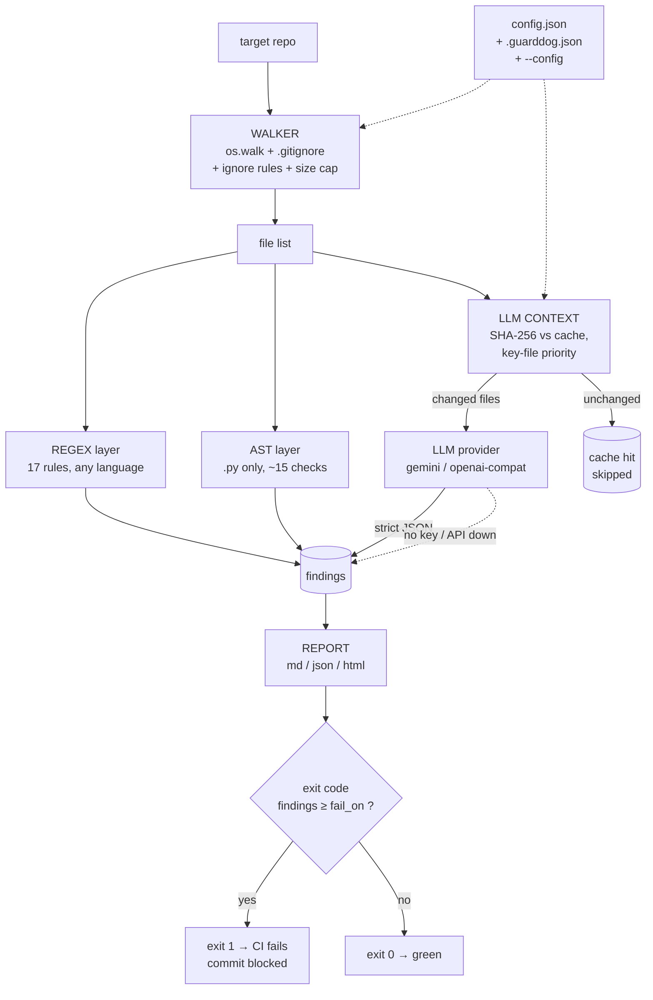
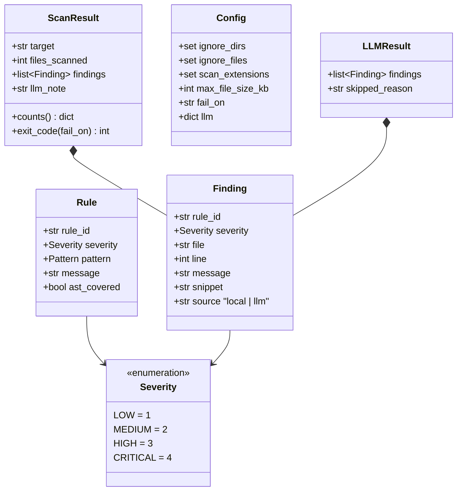

# GuardDOG

[](https://www.python.org/)
[](LICENSE)


[](tests/)

**Hybrid repository scanner for the AI-generated-code era.** A local layer
(regex + AST) catches the obvious instantly and for free; an LLM layer
audits only the files that changed. Findings land in a report and in the
process exit code — a CRITICAL hit fails the build or blocks the commit.

One command in a terminal, a `run_all.bat`, a pre-commit hook, or a CI/CD
pipeline — the project gets checked *before* the incident, not after.

## The problem

AI-generated code looks clean: correct syntax, plausible names, green
tests. Underneath — `PASSWORD = "..."` shipped to prod,
`print(entered_pass)` in a log path, `verify=False` on a payment request.
Linters don't see it: they check style, not semantics. An LLM *can* see
it — but streaming the whole repo into a model on every commit is slow
and burns tokens.

GuardDOG sits in between: the local layer is free and instant, and the LLM
is invoked only on files whose hash changed since the last run — and only
when an API key is present. No key → honest `skipped` in the report, the
local layer still runs. No fake-green, ever.

## Pipeline



## Data model



## Layout

```
GuardDOG/
├── main.py               # thin entry → cli.main()
├── cli.py                # subcommands: scan / install-hook / rules / cache
├── config.py             # config.json → .guarddog.json (target) → --config
├── report.py             # MD / JSON / HTML renderers + severity gate
├── config.json           # single authority: ignores, extensions, fail_on, llm
├── parsers/
│   ├── findings.py       # Finding + Severity (IntEnum) + ScanResult
│   ├── rules.py          # regex rule table — single source of truth
│   ├── regex_scanner.py  # applies the table line-by-line
│   ├── ast_scanner.py    # Python semantics via stdlib ast
│   └── walker.py         # repo walk with the ignore stack
├── llm_client/
│   ├── context.py        # SHA-256 cache + key-file priority ordering
│   └── client.py         # providers: gemini | openai-compatible
├── templates/
│   ├── system_prompt.md  # auditor system prompt (strict JSON contract)
│   └── report.html       # HTML dashboard template (string.Template)
└── tests/                # pytest: walker/regex/ast/report/cli/cache/hook
```

## Usage

```bash
# local layer only (offline, CI, pre-commit)
python main.py scan /path/to/project --no-llm

# full hybrid
export GUARDDOG_API_KEY=<gemini key>      # or OPENAI_API_KEY
python main.py scan /path/to/project

# CI gate: fail on high+, JSON artifact
python main.py scan . --fail-on high --format json -o report.json

# HTML dashboard
python main.py scan . --format html -o report.html

# install a pre-commit hook into a target repo
python main.py install-hook /path/to/project --fail-on high

# list rules / manage the LLM cache
python main.py rules
python main.py cache /path/to/project --clear
```

`guarddog <path>` without a subcommand is shorthand for `guarddog scan <path>`.

**Exit codes:** `0` — clean (below threshold) · `1` — a finding ≥ `fail_on`
exists · `2` — launch error (missing target, hook exists without `--force`).

## How a scan works — stage by stage

**1. Discovery (`walker.iter_source_files`)**
Recursive `os.walk` over the target. Every directory/file is tested against,
in order: `ignore_dirs`/`ignore_files` globs from the merged config → the
target's own `.gitignore` (plain names, `*.ext` globs, `dir/` entries;
`!`-negation and anchored paths are a documented limit) → the
`scan_extensions` allowlist → `max_file_size_kb`. Output: a sorted
`Path` list — deterministic across runs.

**2. Local analysis (per file, no I/O beyond read)**

- Every file goes through `regex_scanner.scan_regex` — the `RULES` table in
  `parsers/rules.py` applied line-by-line.
- `.py` files additionally go through `ast_scanner.scan_ast` — real syntax
  parsing, so `PASSWORD = "x"` inside a *comment* won't fire but
  `db_password = "x"` will, with the variable name in the message.
- Rules marked `ast_covered` are skipped by regex on `.py` — the AST reports
  them instead. One finding, one layer, no duplicates.
- A line carrying `# guarddog: ignore` (optionally with a rule id) suppresses
  findings on that line in both layers.
- AST parse failure (`SyntaxError`) → file skipped, not a crash.

**3. LLM layer (`cli._llm_scan`, skipped entirely by `--no-llm`)**

- `context.build_llm_context` hashes every scanned file (SHA-256) and diffs
  against `.guarddog_cache.json` at the target root. Unchanged → out of the
  payload. Changed files are ordered by `KEY_FILE` priority (models,
  settings, auth, compose, Dockerfile, requirements…) then capped at
  `llm.max_files`.
- `client.audit` dispatches on `llm.provider`: Gemini `generateContent` or
  OpenAI `/chat/completions` (any compatible endpoint via `base_url`). Both
  force JSON output and parse it into `Finding(source="llm")`.
- No key / API error / empty response → `skipped_reason` string lands in the
  report — visible, not swallowed.
- The cache file is written **only after a real API response**. A failed or
  keyless run never gets memoized as "audited".

**4. Report + gate (`report.render`, `ScanResult.exit_code`)**

- `md` — flat table sorted by severity; `json` — machine-readable artifact
  for CI; `html` — self-contained dashboard (severity cards + collapsible
  snippets, zero external assets).
- Default output: `guarddog_report.<fmt>` in the target root; `-o` overrides.
- `exit_code`: `1` if any finding ≥ `fail_on` threshold (`critical` default),
  `never` always returns `0`. Pre-commit and CI consume this directly.

## Extending GuardDOG

| Want to… | Touch |
|---|---|
| Add a regex rule | one `Rule(...)` line in `parsers/rules.py` |
| Add a Python AST check | one branch in `ast_scanner._check_call` / `_check_misc` — and set `ast_covered=True` on the twin regex rule if it exists |
| Add an LLM provider | one function in `llm_client/client.py` + entry in `PROVIDERS` |
| Add a report format | one renderer in `report.py` + entry in `RENDERERS` |
| Change defaults | `config.json`; per-repo tweaks → `.guarddog.json` in that repo |

## Local rules

| Rule | Sev | Detects |
|------|-----|---------|
| `hardcoded-secret` | CRITICAL | `password/api_key/token/secret = "..."` (AST + regex) |
| `private-key-block` | CRITICAL | `-----BEGIN ... PRIVATE KEY-----` committed |
| `cloud-key` | CRITICAL | AWS `AKIA…`, GitHub `ghp_`, Slack `xox*`, OpenAI `sk-` formats |
| `print-secret` | CRITICAL | `print(password)` — secret leaked to stdout |
| `eval-exec` | HIGH | `eval()` / `exec()` on dynamic input |
| `shell-true` | HIGH | `subprocess(..., shell=True)` |
| `verify-false` | HIGH | `verify=False` — TLS verification off |
| `pickle-load` | HIGH | `pickle.load/loads` on untrusted data |
| `yaml-load-unsafe` | HIGH | `yaml.load` without `Loader=` |
| `os-system` | HIGH | `os.system()` — shell injection surface |
| `sql-format-exec` | HIGH | `execute(f"…")` / `%` / string-concat into SQL |
| `debug-enabled` | MEDIUM | `debug=True` / `DEBUG=1` in code or config |
| `bind-all-interfaces` | MEDIUM | binding to `0.0.0.0` |
| `weak-hash` | MEDIUM | `hashlib.md5/sha1`, `createHash('md5')` |
| `cors-wildcard` | MEDIUM | `Access-Control-Allow-Origin: *` |
| `silent-except` | MEDIUM | `except: pass` / `...` bodies (AST) |
| `insecure-tempfile` | MEDIUM | `tempfile.mktemp` — racy |
| `todo-leftover`, `commented-code`, `star-import`, `assert-in-prod`, `long-function` | LOW | hygiene |

On `.py` files, rules marked `ast_covered` are delegated to the AST layer —
one finding, one layer, no duplicates.

## Inline suppression

Kill a false positive where it lives — a comment on the same line:

```python
API_KEY = "test-fixture"   # guarddog: ignore hardcoded-secret
LEGACY = "..."             # guarddog: ignore   ← suppresses all rules on the line
```

Works for both regex and AST findings.

## Configuration

Three layers, later wins (dicts merge, lists append-unique, scalars replace):

1. `config.json` next to the scanner — shipped defaults
2. `.guarddog.json` at the **scanned project** root — per-repo rules
3. `--config <path>` — explicit override

| Key | Controls |
|-----|----------|
| `ignore_dirs` / `ignore_files` | what to skip (target `.gitignore` honored too) |
| `scan_extensions` | file extensions/names to scan |
| `max_file_size_kb` | per-file size cap (default 256) |
| `fail_on` | exit-1 threshold (default `critical`; `never` = always 0) |
| `llm.provider` | `gemini` \| `openai` (`base_url` → Groq/Together/llama.cpp) |
| `llm.model` / `llm.max_files` / `llm.timeout_sec` | LLM layer knobs |

## LLM layer — honest by design

- Keys: `GUARDDOG_API_KEY` → `GEMINI_API_KEY` / `OPENAI_API_KEY`.
- No key → `skipped — no key` in the report; local findings still gate.
- API failure → `skipped — <error>` in the report. A failure is never "clean".
- `.guarddog_cache.json` at the target root; payload = changed files only,
  priority to `models/settings/auth/compose/Dockerfile/…`.
- Cache is committed **only after a real API response** — otherwise a skip
  would get memoized as if it were an audit.

## Principles

- **Verify, don't trust** — every finding carries file:line, no speculation.
- **Fail-closed** — scanner errors surface in the report, never swallowed.
- **Zero runtime deps** — stdlib only: `ast`, `re`, `urllib`, `argparse`.

## Roadmap

- [x] Local layer: 17 regex rules + ~15 AST checks, severity, exit gate
- [x] CLI: `scan` / `install-hook` / `rules` / `cache`, bare-path shorthand
- [x] Reports: Markdown, JSON, self-contained HTML dashboard
- [x] LLM layer: Gemini + OpenAI-compatible providers, SHA-256 context
      cache, key-file priority, strict-JSON parsing
- [x] Per-target config (`.guarddog.json`), inline suppression comments
- [x] Pre-commit hook installer (`install-hook`)
- [ ] Live LLM run against a real key + JSON-schema validation with retry
- [ ] AST rules for JS/TS (tree-sitter)
- [ ] Go rewrite → single binary, when Python hits the wall

## License

MIT — see [LICENSE](LICENSE).
